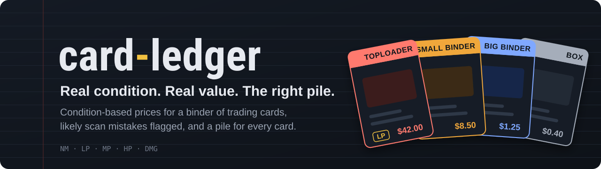
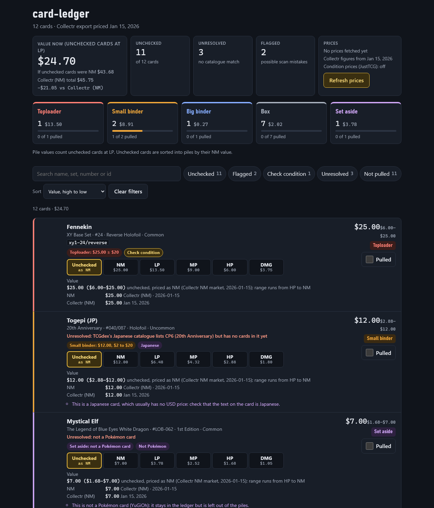
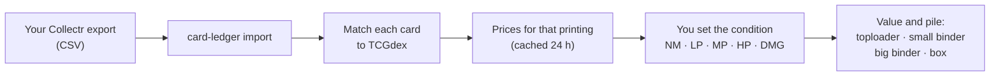
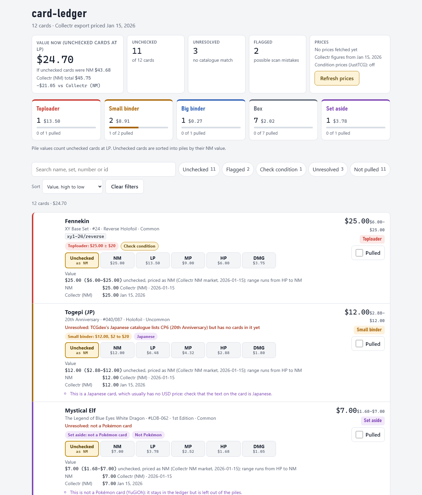
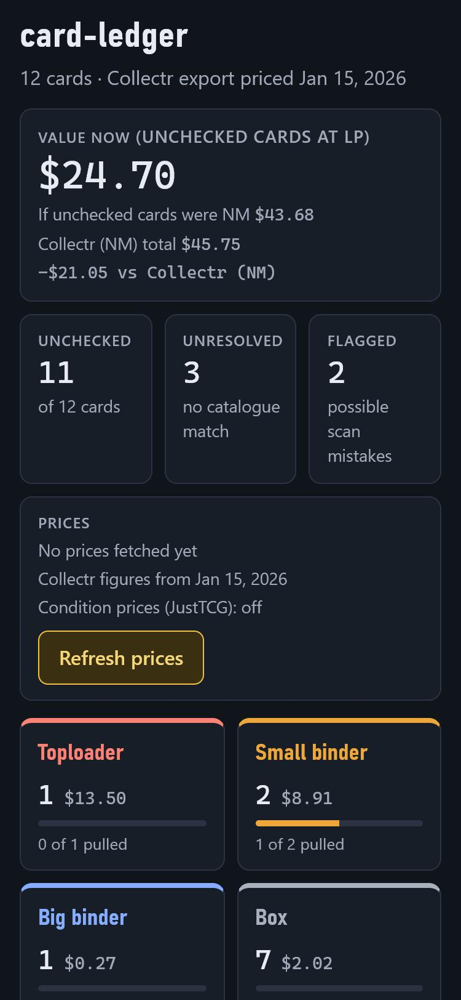
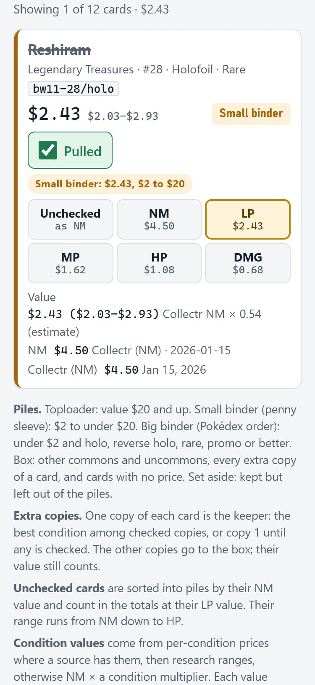

<picture>
  <source media="(prefers-color-scheme: dark)" srcset="assets/brand/banner-dark.svg">
  <source media="(prefers-color-scheme: light)" srcset="assets/brand/banner-light.svg">
  
</picture>

<p align="center">
  <a href="https://github.com/mbustos27/card-ledger/releases/latest"></a>
  <a href="https://github.com/mbustos27/card-ledger/actions/workflows/ci.yml"></a>
  <a href="LICENSE"></a>
  
  
</p>

**Sort a binder of Pokémon TCG cards by what they're really worth in the condition they're really in.** card-ledger is a local collection tracker. It records each card's real condition, prices each card for that condition, flags likely scanner mistakes, and tells you which pile each card goes in: toploader, small binder, big binder or box.

**Reads the CSV you export from Collectr (a PRO feature).** Not affiliated with, endorsed by, or sponsored by Collectr Inc. "Collectr" is a trademark of its owner. Prices in your file come from Collectr's sources; this tool only displays your own file.



## Why card-ledger

- **Nothing is assumed Near Mint.** Every card starts *unchecked*. Pick NM, LP, MP, HP or DMG after a look under a lamp, and its value follows.
- **The right price for the right printing.** Holo, reverse holo and 1st Edition are priced separately, and every value says where it came from and when.
- **Scanner mistakes, flagged.** 1st Edition vs Unlimited, Base Set vs Base Set 2, promo vs set number, Japanese cards: each flag says what to check on the physical card.
- **A pile for every card.** Toploader, small binder, big binder or box, from its value in its condition. Extra copies go to the box as trade stock.
- **Yours, on your computer.** No account, no upload, no tracking. The window runs on `127.0.0.1` only.

## How it works



<table>
  <tr>
    <td width="60%"><br><b>Light theme</b></td>
    <td width="20%"><br><b>Phone, dark</b></td>
    <td width="20%"><br><b>Phone, light</b></td>
  </tr>
</table>

<sub>Screenshots use the made-up sample file and <code>--no-images</code>, so no card art or real prices are shown.</sub>

> card-ledger is an unofficial fan tool. It is not produced, endorsed, supported or affiliated with The Pokémon Company, Nintendo, Game Freak, Creatures or Wizards of the Coast. Pokémon card names, text and images are © their respective owners. No card data, images or prices are included; they are fetched at runtime by the user.

## Quick start (Windows)

1. **Download** `card-ledger-<version>-windows-x64.zip` from [Releases](https://github.com/mbustos27/card-ledger/releases/latest) and unzip it.
2. **Export your collection** from Collectr. Collectr explains how on its [Import / Export help page](https://getcollectr.notion.site/Import-Export-Your-Collection-9aa6e5f4d0cd4efb995dadc992760c8e); the CSV arrives by email. Save it next to `card-ledger.exe`.
3. **Run these** in a terminal in that folder:

   ```
   card-ledger import my-export.csv   # read your file; every card starts "unchecked"
   card-ledger prices                 # match cards to TCGdex and fetch prices (cached 24 h)
   card-ledger ui                     # open the window on http://127.0.0.1:8785/
   ```

4. **In the window:** look at each card under a lamp, set its condition (NM / LP / MP / HP / DMG), and tick it as you pull it into its pile.

Not on Windows? It builds anywhere Rust does: `cargo build --release`. Data then lives in `~/.local/share/card-ledger` (or `$XDG_DATA_HOME`), and the window opens in any browser.

## How values work

- **Nothing is assumed Near Mint.** Collection apps mark every card NM by default, so every card starts *unchecked* until you set its condition.
- **NM price:** the TCGplayer market price for that exact printing (holo, reverse holo, 1st Edition…), carried by [TCGdex](https://tcgdex.dev). A reverse-holo price is never used for a normal card, and EUR figures are never mixed with USD.
- **Condition value**, first match wins:
  1. **Per-condition prices** from JustTCG, if you've set your own key (see below).
  2. **Research ranges** you add for specific cards (`data/research-values.json`).
  3. **NM × a condition multiplier:** LP 0.54, MP 0.36, HP 0.24, DMG 0.15, with a low–high band. These come from TCGplayer per-condition prices and sales across a sample of cards, and live in `data/conditions.toml`.
- **Unchecked cards** are piled by their NM value, so nothing worth looking at lands in the box before you've seen it. They show a range down to HP and a "check condition" flag when wear would move them to a cheaper pile.
- **Totals** count unchecked cards at their LP value; the all-NM figure is shown beside it.
- **Every value says where it came from and when**, e.g. "TCGdex · TCGplayer NM market · 2026-11-24".

## Piles

| Pile | Rule |
|---|---|
| Toploader | $20 and up |
| Small binder | $2 up to $20 (penny sleeve) |
| Big binder | under $2 and holo, reverse holo, rare or promo; in Pokédex order |
| Box | everything else, including every extra copy of a card |
| Set aside | not a Pokémon card (e.g. a stray Yu-Gi-Oh! card) |

When you own several copies of a card, one copy is the **keeper** and takes the pile its value earns. The keeper is your best-condition copy among those you've checked, or copy 1 until you've checked any. The other copies go to the box as trade stock ("Extra copy → box"), and their value still counts in the totals. A graded slab is never an extra copy of the raw card.

## Commands

```
card-ledger import <export.csv> [--dry-run]    read or re-read your export (never deletes)
card-ledger prices [--max-age-hours N] [--rematch]  match new cards, refresh prices older than N h
card-ledger match [--rematch]                  match cards only, fetch no prices
card-ledger ui [--port N] [--no-open] [--no-images]  the window (default http://127.0.0.1:8785/)
card-ledger list [--pile P] [--unchecked] [--flagged] [--unresolved] [--check]
card-ledger show <copy-id>                     everything about one card
card-ledger condition <copy-id> <NM|LP|MP|HP|DMG|unchecked>
card-ledger pulled <copy-id> [yes|no]
card-ledger carry-over <old-item> <new-item>   keep your conditions after fixing a line in Collectr
card-ledger summary                            piles, totals, counts
card-ledger justtcg-key set|status|clear       your JustTCG key (optional)
```

Your data lives in `%APPDATA%\card-ledger\ledger.db`. On Linux and macOS it's `~/.local/share/card-ledger`. Set `CARD_LEDGER_DATA_DIR` to use another folder.

## FAQ

**Why doesn't it trust the export's "Near Mint"?** Collection apps default every card to NM. Cards from a binder are usually lightly to moderately played, and LP often sells for about half of NM. card-ledger keeps the export's figure as a reference ("Collectr (NM)") and never uses it as your card's condition.

**What are the flags?** Likely scanner mistakes, each with what to look at on the physical card: a printing that doesn't exist for that card, 1st Edition vs Unlimited, Base Set vs Base Set 2, a promo vs the set version, Radiant Collection numbers, Japanese cards, and prices far from the expected range. Flags never change anything by themselves.

**Why is a card "unresolved"?** TCGdex has no match: some Japanese sets have no card list yet, some starter decks aren't in the catalogue, and non-Pokémon cards are kept but set aside. The reason is shown on each card, and its value falls back to the export's figure.

**Japanese cards?** They're matched in TCGdex's Japanese catalogue where it has the set, and are never given an English card's USD price.

**Graded slabs?** A graded line is kept as its own card. Its value currently comes from raw prices, which understates a slab.

**The JustTCG key?** It's optional. JustTCG has real per-condition prices; card-ledger works without it. Get a free key from [justtcg.com](https://justtcg.com) yourself, then run `card-ledger justtcg-key set` and paste it. On Windows it's saved in Credential Manager; elsewhere it goes in a file in your data folder. It's never printed or logged, it's sent only to `api.justtcg.com`, and the window shows just its last four characters. JustTCG's free plan is for personal, non-commercial use, so card-ledger counts requests to stay inside it and has no way to export or share its prices.

## Privacy

Everything stays on your computer. The window is served on `127.0.0.1` only and refuses requests from other sites. card-ledger never signs in to Collectr, reads your email, uploads your collection, or shares or exports the prices it caches. The only outside requests are to TCGdex (card data, prices, card images) and, if you set a key, JustTCG.

## Data sources and attribution

- **Card data:** [TCGdex](https://tcgdex.dev), an open-source database (MIT; site content CC BY-SA 4.0).
- **Prices shown via TCGdex** come from Cardmarket and TCGplayer; neither endorses card-ledger.
- **Optional condition prices:** [JustTCG](https://justtcg.com), using your own API key.

Requests go one at a time, with an honest User-Agent and a pause between them, and answers are cached in your data folder, as TCGdex asks. A 429 or Retry-After is honoured, and a bot-check page stops the run. card-ledger doesn't scrape websites.

## Building and contributing

```
cargo test
cargo clippy --all-targets -- -D warnings
cargo build --release
```

`data/sets.toml` maps the export's set names to TCGdex set ids, `data/conditions.toml` holds the multipliers and pile thresholds, and `data/research-values.json` holds optional per-card ranges (it ships empty; see `crates/core/tests/fixtures/research-sample.json` for the format). All three are built into the program, so edit them and rebuild.

If you publish a build, strip your home folder path out of the exe first: set `RUSTFLAGS` to `--remap-path-prefix=<your home folder>=~` before building, then search the exe for your user name before you share it.

See [CONTRIBUTING.md](CONTRIBUTING.md), [SECURITY.md](SECURITY.md) and [CHANGELOG.md](CHANGELOG.md).

## License

MIT for the card-ledger code; see [LICENSE](LICENSE). Card names, text, images and prices belong to their owners. They're fetched at runtime and are not part of this project.
